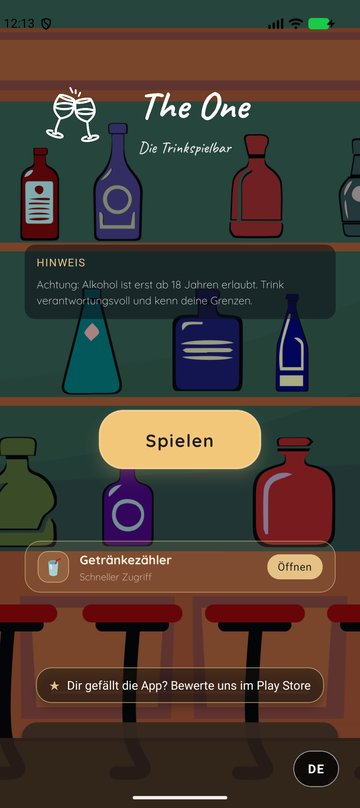
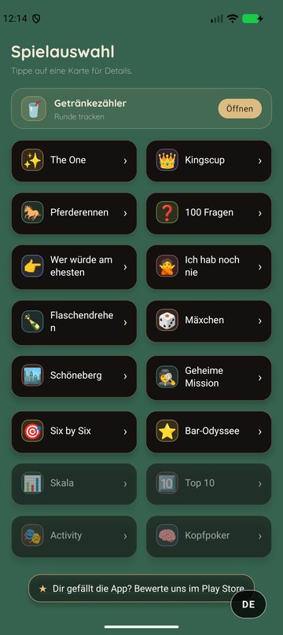
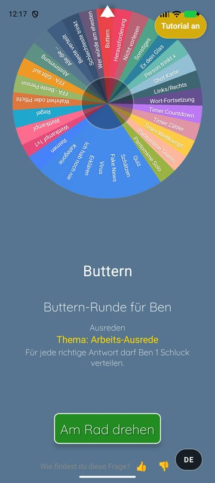
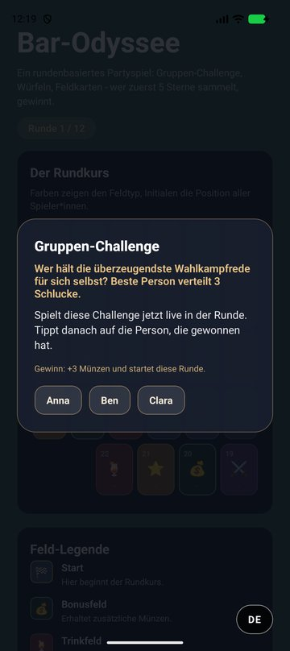

# The One: Party Game App

A cross-platform party and group game app: one app, twelve game modes, from well-known classics
to self-designed games. Players are added once at the start and are carried through every game;
the app handles turns, cards, prompts and rules so the group can focus on playing.

The repository contains the mobile client (React Native / Expo) and a REST backend written in
Rust for serving game content and collecting feedback.


| Start | Game selection | The One | Bar Odyssey |
| --- | --- | --- | --- |
|  |  |  |  |

---

## Game Modes

| Game | Description |
| --- | --- |
| **The One** | Wheel of fortune with around 30 task categories: truth or dare, quiz, pantomime, duels, rules and more |
| **Bar Odyssey** *(beta)* | Turn-based board game in the style of Mario Party: group challenges, dice, event fields |
| **100 Questions** | Large pool of conversation questions |
| **Never Have I Ever** | The classic, with curated prompt decks |
| **Who Would Most Likely** | Group voting game |
| **Spin the Bottle** | Animated bottle with separate truth and dare pools |
| **Secret Mission** | Each player secretly receives a mission to complete during the evening |
| **Kings (card game)** | Card game with a digital deck |
| **Horse Race** | Card-based race with side cards revealed row by row |
| **Six by Six** | Card guessing game |
| **Schöneberg** | Self-designed card game |
| **Mäxchen** | The classic dice bluffing game |

In development: *Scale*, *Top 10*, *Activity* and *Head Poker*.

Before a game starts, it shows a short description and ratings for intensity and "getting to
know each other". The pre-game settings let the group tune the intensity of the prompts.

## Features

- **Shared player management:** players are entered once and used by all game modes. Players
  can opt out of certain task types.
- **Content memory:** the app remembers which prompts were already shown and prefers unseen
  content, so long sessions don't repeat themselves (without ever running out of content).
- **Localization:** German and English.
- **Offline-first:** all game content is bundled with the app; no connection required.
- **Custom UI:** own design system with category colors, custom fonts and animations.

## Architecture

```
The One
├── Game_RN/                    Mobile client (React Native / Expo)
│   ├── App.js                  Navigation and app-wide state
│   └── src/
│       ├── games/              One module per game mode (UI + game logic)
│       ├── menus/              Start menu, player setup, game selection, pre-game settings
│       ├── data/               Bundled prompt pools and word lists
│       ├── i18n/               Translations (DE/EN)
│       └── utils/              Content memory, rating, shared helpers
├── Backend/
│   ├── rocket/rocket_server/   REST API in Rust (Rocket, SQLx, MySQL)
│   └── js/                     Earlier Node.js/Express implementation of the API
└── Inhalt/                     Source material for the prompt decks
```

**Client.** Each game mode is a self-contained screen with its own game logic. Navigation is
handled by React Navigation; shared state (players, language, settings) is provided via React
Context and persisted with AsyncStorage.

**Backend.** The Rust service exposes endpoints for game content and feedback and connects to
a MySQL database via SQLx. It replaces an earlier Node.js/Express implementation that is kept
for reference. The client currently runs entirely on bundled content; the API connection can be
re-enabled in `Game_RN/src/general.js`.

**Release pipeline.** Android builds are created and published to Google Play with EAS Build and
EAS Submit, with separate profiles for the internal test track and the production release.

## Tech Stack

| Area | Technology |
| --- | --- |
| Mobile | React Native 0.81, Expo SDK 54, React 19, React Navigation |
| Persistence | AsyncStorage |
| Backend | Rust, Rocket 0.5, SQLx, MySQL (Node.js/Express as predecessor) |
| Build & Release | EAS Build, EAS Submit, Google Play |
| Tooling | ESLint, patch-package |

## Getting Started

```bash
cd Game_RN
npm install
npm start
```

Scan the QR code with Expo Go, or run `npm run android` to start on an Android emulator.

Further documentation:
- [Game_RN/README.md](Game_RN/README.md): development workflow, builds and store releases
- [Game_RN/SETUP.md](Game_RN/SETUP.md): one-time environment setup
- [Backend/rocket/rocket_server/README.md](Backend/rocket/rocket_server/README.md): backend setup
